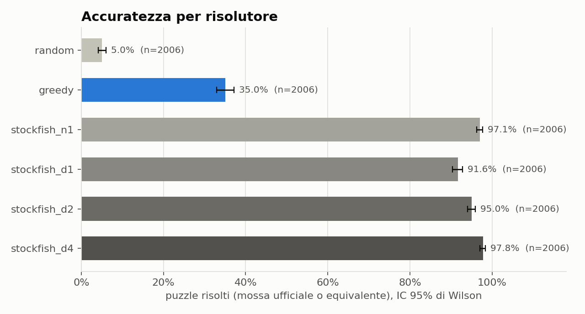
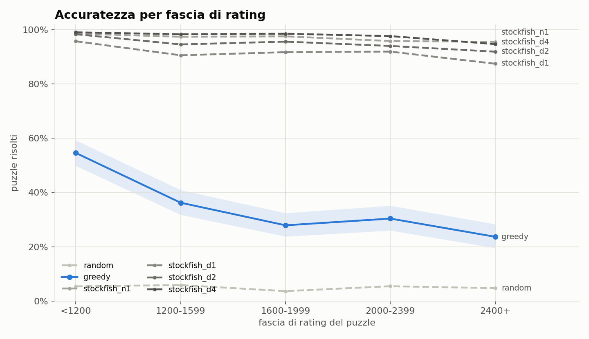
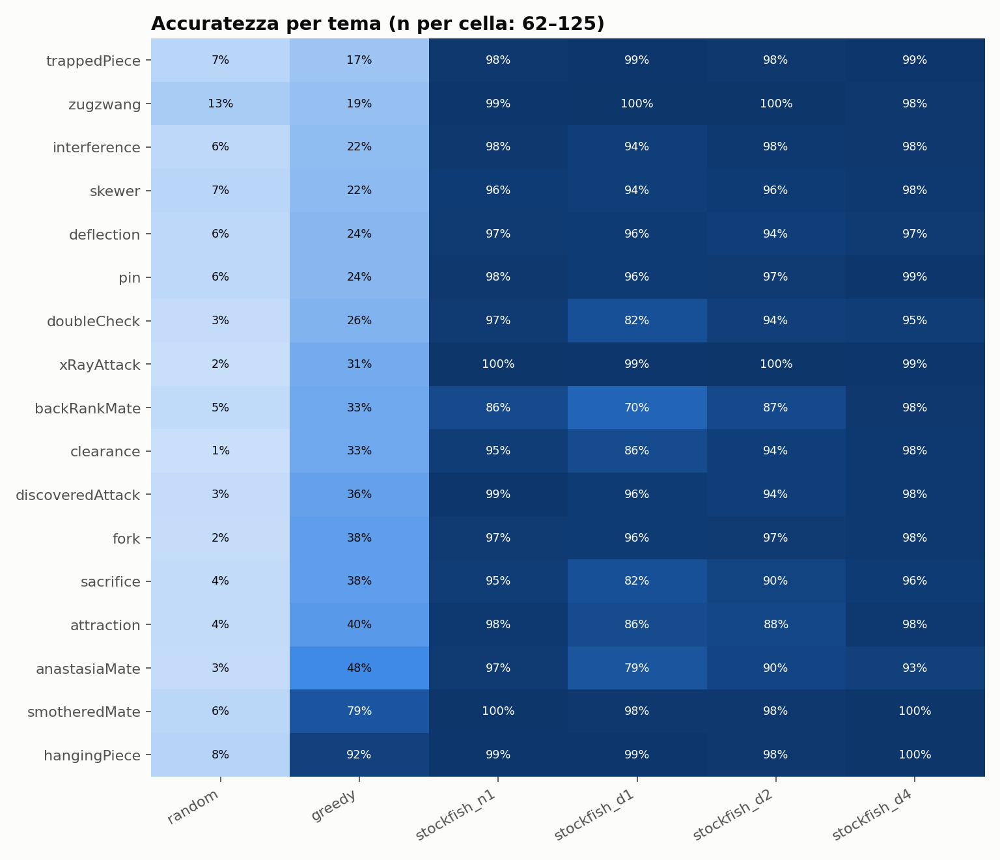
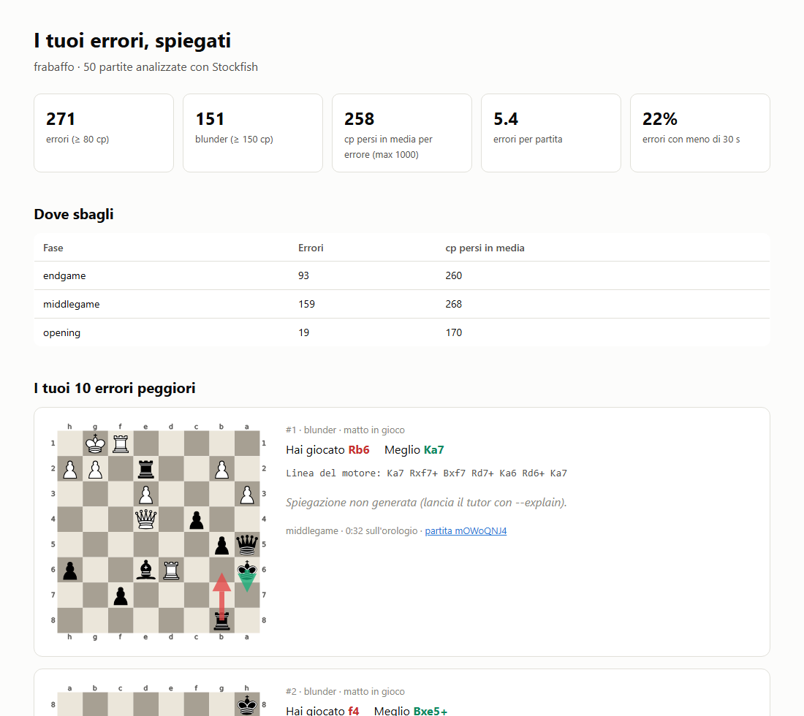
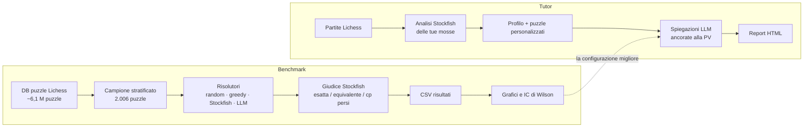

# chess-llm-tutor

**Quanto sono bravi gli LLM a risolvere puzzle di scacchi, e quanto conta il
modo in cui gli descrivi la posizione?** Il progetto lo misura su 2.006 puzzle
Lichess, con Stockfish come giudice, e usa quello che impara per costruire un
tutor che spiega i tuoi errori di partita.

Due parti, in quest'ordine:

1. **Benchmark**: puzzle stratificati per rating e tema, quattro
   rappresentazioni della posizione, sei baseline, intervalli di confidenza su
   ogni numero.
2. **Tutor**: le tue partite Lichess → errori → profilo di debolezze → puzzle
   costruiti sulle tue posizioni → report HTML con le spiegazioni.

La parte 1 giustifica la parte 2. Invece di "ho messo un LLM sopra Stockfish",
il progetto dice "ho misurato dove l'LLM sbaglia e ho progettato il sistema
attorno a quel limite": l'LLM spiega la linea del motore, non la calcola.

## Stato

| Parte | Stato |
| --- | --- |
| Dataset e campionamento (2.006 puzzle, 5 fasce di rating × 17 temi, ≤ 25 per cella) | Fatto |
| Baseline: random, greedy, Stockfish a 4 livelli | Fatto, risultati sotto |
| Run LLM (4 rappresentazioni, via Batch API) | Pronto, non ancora lanciato |
| Grafici e numeri chiave delle domande di ricerca | Fatto |
| Tutor con report HTML | Fatto; spiegazioni LLM opzionali |

55 test, tutti verdi.

## Risultati finora: le baseline

Prima di misurare un LLM servono un pavimento, un tetto e soprattutto un metro
che vari con la difficoltà. Su tutti i 2.006 puzzle:



- **random** risolve il 5,0%: la conferma che la posizione viene estratta bene
  dal dataset (`PLAN.md` fissa la soglia d'allarme fra il 5 e l'8%).
- **greedy** risolve il 35,0%. Gioca la mossa "visibile" senza calcolare: matto
  in 1, altrimenti la cattura più redditizia, altrimenti uno scacco.
- **Stockfish** risolve fra il 91,6% (profondità 1) e il 97,8% (profondità 4).

Il punto che conta per la domanda RQ2 è come cambiano con la difficoltà:



`greedy` scende dal 55% sotto i 1200 al 24% sopra i 2400; Stockfish resta
piatto. È `greedy` il metro contro cui leggere la curva dell'LLM: un LLM che
gli resta parallelo sta vedendo le tattiche immediate senza calcolare.

> **Una sorpresa lungo la strada.** Limitare Stockfish a un nodo
> (`stockfish_n1`) sembrava il modo naturale di ottenere una baseline debole.
> Non lo è: Stockfish completa sempre almeno un'iterazione, quindi con
> `nodes=1` esplora comunque ~60 nodi a profondità 2 e risolve il 97%.
> Da qui la baseline `greedy`.

Per tema, la mossa visibile basta quasi sempre per i pezzi in presa (92%) e
quasi mai per inchiodature, infilate, pezzi intrappolati e zugzwang (17–24%):



Quando sbagliano, le baseline sbagliano di molto: la mossa sbagliata di
`greedy` costa una mediana di 930 centipawn, quasi sempre un pezzo intero, e
due errori su tre di Stockfish a profondità 1 coinvolgono un matto forzato
([grafico](results/figures/cp_loss.png)). Tutti i numeri, con gli intervalli di
confidenza, sono in [`results/figures/summary.md`](results/figures/summary.md).

## Le domande di ricerca

| | Domanda | Cosa serve per rispondere |
| --- | --- | --- |
| **RQ1** | La rappresentazione conta più della difficoltà? Stessa posizione come FEN, diagramma ASCII, lista dei pezzi, lista + mosse legali. | Run LLM sulle 4 rappresentazioni |
| **RQ2** | La curva per rating crolla netta o cala piano? | Run LLM + la curva di `greedy` qui sopra |
| **RQ3** | Riconoscere il motivo tattico è più facile che trovare la mossa? | Run LLM: il modello dichiara anche il tema |

Se la risposta a RQ3 è sì, il modello *capisce* il tipo di posizione ma non sa
calcolare. È esattamente ciò che autorizza il design del tutor: all'LLM si
chiede di spiegare l'analisi del motore, non di calcolarla.

## Il tutor

```bash
python scripts/tutor.py --user <username-lichess> --max-games 50
```

Scarica le partite, le analizza con Stockfish mossa per mossa (solo le tue),
raccoglie gli errori da almeno 80 centipawn e produce un report HTML
autonomo: il profilo, i 10 errori peggiori su scacchiera e una serie di puzzle
costruiti sulle posizioni in cui hai sbagliato.



Su 50 partite di prova (46 blitz 3+2, rating mediano 1728) ha trovato 271
errori, 5,4 a partita, di cui 151 blunder. Con meno di 30 secondi
sull'orologio la quota di mosse sbagliate sale dal 18% al 25%.

Con `--explain` ogni errore riceve due paragrafi scritti dall'LLM, a partire
dalla linea principale di Stockfish. Il prompt vieta di inventare varianti: è
lì che gli LLM sbagliano con più sicurezza, e uno strumento didattico che
produce analisi eloquenti e sbagliate è il peggior risultato possibile.

## Come funziona



## Quick start

Requisiti: Python 3.12 (la versione su cui gira la suite di test) e Stockfish.

```bash
python -m venv .venv && source .venv/bin/activate     # Windows: .venv\Scripts\Activate.ps1
pip install -r requirements.txt

# Stockfish
sudo apt install stockfish        # Debian/Ubuntu
brew install stockfish            # macOS
python scripts/get_stockfish.py   # Windows: scarica la build giusta per la CPU in bin/
# oppure: export STOCKFISH_PATH=/percorso/del/binario

pytest -q                         # 55 test, ~5 s
```

Una prova a secco, senza scaricare nulla e senza chiamate API:

```bash
python scripts/run_benchmark.py --puzzles tests/fixtures/puzzles_sample.csv --dry-run
```

## Riprodurre i risultati

I dati e i CSV dei risultati non sono nel repository (il database dei puzzle
pesa oltre 1 GB); i grafici sì. Per rigenerare tutto:

**1. Il campione** (download unico; il CSV scompattato pesa ~1,1 GB):

```bash
python scripts/download_puzzles.py --per-cell 25 --out data/sample.csv
```

**2. Le baseline** (nessuna chiamata API, circa un'ora):

```bash
python scripts/run_benchmark.py --puzzles data/sample.csv --dry-run \
    --baselines random greedy stockfish_d1 stockfish_d2 stockfish_d4 \
    --out results/baselines.csv
```

Un run interrotto riparte con `--resume`: le righe già scritte restano, quelle
con un errore API vengono ritentate.

**3. Il run LLM.** Il benchmark interroga il modello una richiesta alla volta,
e con il ragionamento attivo 8.000 chiamate richiedono decine di ore.
`llm_batch.py` invia le stesse richieste con la Message Batches API (metà
prezzo, di solito finito entro un'ora) e scrive le risposte nella cache che il
benchmark legge.

```bash
export ANTHROPIC_API_KEY=...

# pilota: 200 puzzle, una rappresentazione (~$2,5 stimati con Sonnet 5.5)
python scripts/llm_batch.py submit --puzzles data/sample.csv --limit 200 \
    --representations piece_list --dry-run     # conta le richieste e stima il costo
python scripts/llm_batch.py submit --puzzles data/sample.csv --limit 200 --representations piece_list
python scripts/llm_batch.py collect --wait
python scripts/run_benchmark.py --puzzles data/sample.csv --limit 200 --baselines \
    --representations piece_list --out results/pilot.csv

# completo: 2.006 puzzle × 4 rappresentazioni (~$100 stimati con Sonnet 5.5)
python scripts/llm_batch.py submit --puzzles data/sample.csv \
    --representations fen ascii piece_list piece_list_moves
python scripts/llm_batch.py collect --wait
python scripts/run_benchmark.py --puzzles data/sample.csv --baselines \
    --representations fen ascii piece_list piece_list_moves --out results/llm.csv
```

Modello, `--effort`, `--max-tokens` e rappresentazioni devono coincidere fra i
due script: fanno parte della chiave di cache.

**4. Grafici e numeri chiave:**

```bash
python scripts/plots.py --results results/baselines.csv results/llm.csv
```

Scrive in `results/figures/` i grafici di RQ1, RQ2 e RQ3, la heatmap per tema,
la distribuzione dei centipawn persi e `summary.md` con le tre frasi dei
criteri di successo, già con i numeri.

<details>
<summary><b>Guardare i singoli casi dietro le tabelle</b></summary>

Il CSV ha una riga per (puzzle, risolutore), con FEN, mossa attesa, mossa data,
cp persi e, per l'LLM, la risposta integrale.

```bash
python scripts/inspect_results.py --results results/baselines.csv --failed       # non risolti, per cp persi
python scripts/inspect_results.py --results results/llm.csv --illegal            # mosse illegali
python scripts/inspect_results.py --results results/llm.csv --equivalent         # risolti senza la mossa ufficiale
python scripts/inspect_results.py --results results/llm.csv --errors             # chiamate API fallite
python scripts/inspect_results.py --results results/llm.csv --puzzle 9rklp --raw # scheda + risposta integrale
```

</details>

<details>
<summary><b>Note sull'uso dell'API</b></summary>

- Le risposte vanno in cache su disco (`results/llm_cache.jsonl`) con una
  chiave che include modello, `effort` e `max_tokens`. Rilanciare il benchmark
  dopo aver cambiato le metriche non costa nulla, e cambiare modello non riusa
  per sbaglio le risposte di un altro.
- I modelli attuali non accettano `temperature` e ragionano prima di
  rispondere: i token di ragionamento contano in `--max-tokens` (default
  16.000). La riproducibilità si affida a un `--effort` fisso più la cache.
  Per i modelli che non supportano `effort` (es. `claude-haiku-4-5`):
  `--effort none`.
- Nessun fallback automatico su un altro modello in caso di rifiuto: la
  risposta di un modello diverso contaminerebbe il confronto.
- Le chiamate fallite (rate limit, rifiuti, risposte troncate) finiscono nella
  colonna `error` e sono escluse dai tassi, non contate come mosse illegali.

</details>

## Scelte metodologiche

**Il campo FEN del dataset Lichess non è la posizione del puzzle.** È la
posizione *prima* della mossa avversaria; la posizione da risolvere si ottiene
applicando la prima mossa di `Moves`. È l'errore più comune con questo dataset
e produce metriche plausibili ma senza senso. Il test
`test_setup_fen_is_not_puzzle_fen` fallisce se qualcuno "semplifica" il passaggio.

**Una mossa illegale resta illegale.** Il parser accetta SAN e UCI e tollera
markdown, numeri di mossa, figurine Unicode e arrocchi scritti con gli zeri, ma
non cerca la mossa legale "più simile". Aggiustare le risposte gonfia
l'accuratezza; il tasso di mosse illegali è di per sé un risultato.

**Risolto ≠ mossa ufficiale.** Un puzzle conta come risolto se la mossa
coincide con la soluzione di Lichess *oppure* se il motore la giudica
equivalente (entro 30 centipawn). Con un matto forzato in gioco la tolleranza
non basta: compressi in centipawn, matto in 1 e matto in 10 distano 9 cp, quindi
serve un matto altrettanto rapido. Le due metriche restano separate nel CSV
(`exact_match`, `engine_equivalent`).

**Il tema si riconosce per frase, non per parola.** `theme_correct` accetta i
sinonimi di `THEME_SYNONYMS` ("double attack" per `fork`, "x-ray" per
`xRayAttack`), non parole generiche come "attack", "piece" o "mate", che
gonfierebbero proprio RQ3.

**Ogni tasso ha il suo intervallo.** Con 25 puzzle per cella la differenza fra
60% e 68% non è distinguibile dal rumore: `metrics.py` riporta sempre
l'intervallo di Wilson al 95%, e il confronto fra rappresentazioni usa la
differenza appaiata sugli stessi puzzle.

**Riproducibile.** Stockfish gira con `Threads=1` (valutazioni deterministiche
a parità di profondità), il campionamento ha un seed fisso, le risposte
dell'LLM restano in cache.

**Nel tutor, i matti non dominano le medie.** Un matto concesso vale ~10.000 cp
compressi: le medie del profilo tagliano ogni perdita a 1.000 cp. La mossa che
Stockfish stesso considera migliore non è mai contata come errore, anche quando
la valutazione un ply dopo esce più bassa per instabilità della ricerca.

## Struttura

```
src/chesstutor/
  dataset.py          caricamento e campionamento stratificato dei puzzle
  representations.py  4 modi di descrivere una posizione + prompt
  solvers.py          Random / Greedy / Stockfish / LLM, parser, cache
  engine.py           wrapper Stockfish: valutazioni, giudizio delle mosse
  benchmark.py        il runner: puzzle × risolutore → CSV, ripresa dei run
  metrics.py          aggregazione con intervalli di Wilson
  analysis.py         PGN → errori → profilo → puzzle personalizzati
  report.py           report HTML del tutor
scripts/
  get_stockfish.py    scarica Stockfish in bin/ (Windows)
  download_puzzles.py scarica il DB Lichess e campiona
  run_benchmark.py    il benchmark, con report finale
  llm_batch.py        riempie la cache LLM con la Batch API
  plots.py            grafici RQ1/RQ2/RQ3 e numeri chiave
  inspect_results.py  i singoli casi dietro le tabelle
  tutor.py            partite Lichess → report HTML
tests/                suite pytest + puzzle di fixture verificati
results/figures/      grafici e numeri chiave delle baseline
PLAN.md               piano di lavoro e criteri di successo
```

## Dati

- Puzzle: [database.lichess.org](https://database.lichess.org/) (CC0).
- Partite: [API Lichess](https://lichess.org/api), endpoint
  `/api/games/user/{username}`. Nessuna autenticazione per le partite
  pubbliche; serve però un `User-Agent` esplicito, perché quello di default di
  `requests` riceve un 404.
- Motore: [Stockfish](https://stockfishchess.org/) (GPL-3.0), non incluso nel
  repository.
