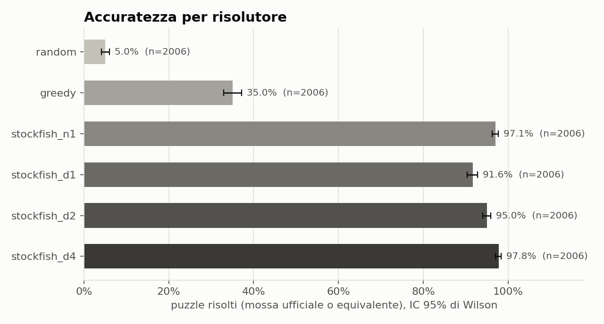
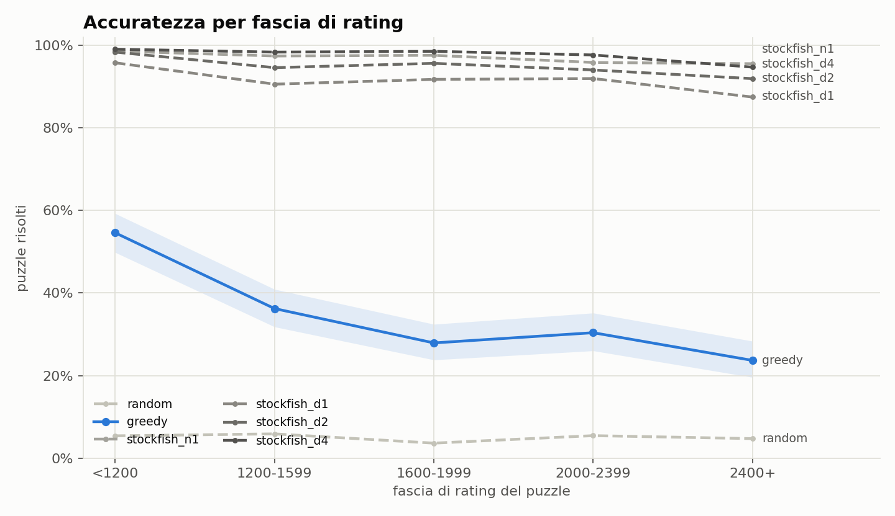
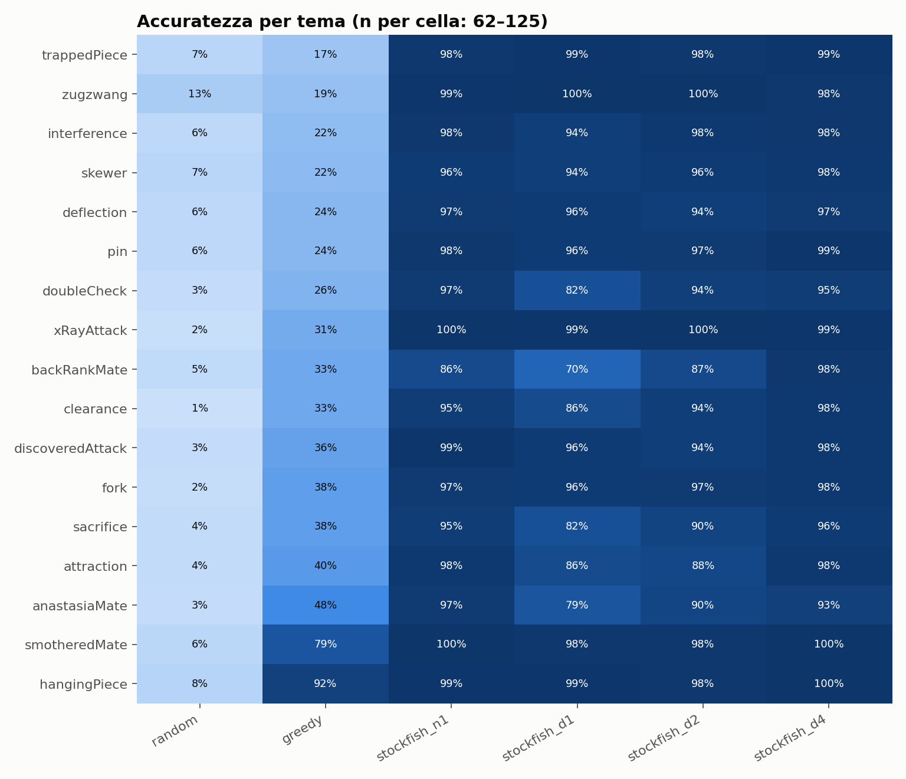
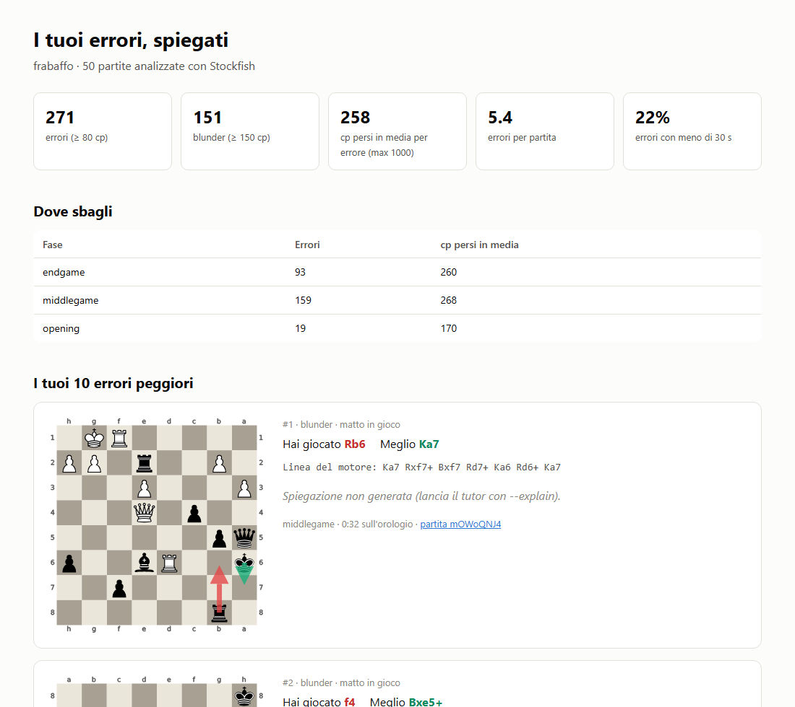
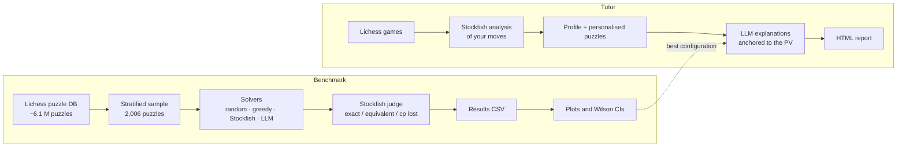

# chess-llm-tutor

**How good are LLMs at solving chess puzzles, and how much does the way you describe the
position matter?** This project measures it on 2,006 Lichess puzzles, with Stockfish as the
judge, and uses what it learns to build a tutor that explains the mistakes in your games.

Two parts, in this order:

1. **Benchmark**: puzzles stratified by rating and theme, four representations of the
   position, six baselines, confidence intervals on every number.
2. **Tutor**: your Lichess games → mistakes → weakness profile → puzzles built from your own
   positions → HTML report with explanations.

Part 1 justifies part 2. Instead of "I put an LLM on top of Stockfish", the project says "I
measured where the LLM fails and designed the system around that limit": the LLM explains the
engine's line, it does not calculate it.

## Status

| Part | Status |
| --- | --- |
| Dataset and sampling (2,006 puzzles, 5 rating bands × 17 themes, ≤ 25 per cell) | Done |
| Baselines: random, greedy, Stockfish at 4 levels | Done, results below |
| LLM run (4 representations, via Batch API) | Ready, not launched yet |
| Plots and key numbers for the research questions | Done |
| Tutor with HTML report | Done; LLM explanations optional |

55 tests, all green.

## Results so far: the baselines

Before measuring an LLM you need a floor, a ceiling and above all a yardstick that varies with
difficulty. On all 2,006 puzzles:



- **random** solves 5.0%: confirmation that the position is extracted correctly from the
  dataset (`PLAN.md` sets the alarm threshold between 5 and 8%).
- **greedy** solves 35.0%. It plays the "visible" move without calculating: mate in 1,
  otherwise the most profitable capture, otherwise a check.
- **Stockfish** solves between 91.6% (depth 1) and 97.8% (depth 4).

What matters for RQ2 is how they change with difficulty:



`greedy` drops from 55% below 1200 to 24% above 2400; Stockfish stays flat. `greedy` is the
yardstick for reading the LLM curve: an LLM that runs parallel to it is seeing immediate
tactics without calculating.

> **A surprise along the way.** Limiting Stockfish to one node (`stockfish_n1`) looked like the
> natural way to get a weak baseline. It isn't: Stockfish always completes at least one
> iteration, so with `nodes=1` it still explores ~60 nodes at depth 2 and solves 97%.
> Hence the `greedy` baseline.

By theme, the visible move is almost always enough for hanging pieces (92%) and almost never for
pins, skewers, trapped pieces and zugzwang (17–24%):



When the baselines are wrong, they are very wrong: `greedy`'s wrong move costs a median of 930
centipawns, almost always a whole piece, and two out of three Stockfish depth-1 errors involve a
forced mate ([plot](results/figures/cp_loss.png)). All numbers, with confidence intervals, are in
[`results/figures/summary.md`](results/figures/summary.md).

## Research questions

| | Question | What is needed to answer |
| --- | --- | --- |
| **RQ1** | Does the representation matter more than difficulty? Same position as FEN, ASCII diagram, piece list, piece list + legal moves. | LLM run on the 4 representations |
| **RQ2** | Does accuracy collapse sharply with rating or decline gradually? | LLM run + the `greedy` curve above |
| **RQ3** | Is recognising the tactical motif easier than finding the move? | LLM run: the model also states the theme |

If the answer to RQ3 is yes, the model *understands* the type of position but cannot calculate.
That is exactly what justifies the tutor's design: the LLM is asked to explain the engine's
analysis, not to compute it.

## The tutor

```bash
python scripts/tutor.py --user <lichess-username> --max-games 50
```

It downloads your games, analyses them move by move with Stockfish (your moves only), collects
mistakes of at least 80 centipawns and produces a self-contained HTML report: your profile, your
10 worst mistakes on a board and a set of puzzles built from the positions where you went wrong.



On 50 test games (46 blitz 3+2, median rating 1728) it found 271 mistakes, 5.4 per game, of which
151 were blunders. With less than 30 seconds on the clock the share of bad moves rises from 18%
to 25%.

With `--explain` each mistake gets two paragraphs written by the LLM, starting from Stockfish's
principal variation. The prompt forbids inventing variations: that is where LLMs are most
confidently wrong, and a teaching tool that produces eloquent but wrong analysis is the worst
possible outcome.

## How it works



## Quick start

Requirements: Python 3.12 (the version the test suite runs on) and Stockfish.

```bash
python -m venv .venv && source .venv/bin/activate     # Windows: .venv\Scripts\Activate.ps1
pip install -r requirements.txt

# Stockfish
sudo apt install stockfish        # Debian/Ubuntu
brew install stockfish            # macOS
python scripts/get_stockfish.py   # Windows: downloads the right build for your CPU into bin/
# or: export STOCKFISH_PATH=/path/to/binary

pytest -q                         # 55 tests, ~5 s
```

A dry run, with no downloads and no API calls:

```bash
python scripts/run_benchmark.py --puzzles tests/fixtures/puzzles_sample.csv --dry-run
```

## Reproducing the results

Data and result CSVs are not in the repository (the puzzle database is over 1 GB); the plots are.
To regenerate everything:

**1. The sample** (one-off download; the unpacked CSV is ~1.1 GB):

```bash
python scripts/download_puzzles.py --per-cell 25 --out data/sample.csv
```

**2. The baselines** (no API calls, about one hour):

```bash
python scripts/run_benchmark.py --puzzles data/sample.csv --dry-run \
    --baselines random greedy stockfish_d1 stockfish_d2 stockfish_d4 \
    --out results/baselines.csv
```

An interrupted run restarts with `--resume`: rows already written are kept, rows with an API
error are retried.

**3. The LLM run.** The benchmark queries the model one request at a time, and with reasoning
enabled 8,000 calls take tens of hours. `llm_batch.py` sends the same requests through the
Message Batches API (half price, usually done within an hour) and writes the answers into the
cache the benchmark reads.

```bash
export ANTHROPIC_API_KEY=...

# pilot: 200 puzzles, one representation (~$2.5 estimated with Sonnet 5.5)
python scripts/llm_batch.py submit --puzzles data/sample.csv --limit 200 \
    --representations piece_list --dry-run     # counts requests and estimates cost
python scripts/llm_batch.py submit --puzzles data/sample.csv --limit 200 --representations piece_list
python scripts/llm_batch.py collect --wait
python scripts/run_benchmark.py --puzzles data/sample.csv --limit 200 --baselines \
    --representations piece_list --out results/pilot.csv

# full: 2,006 puzzles × 4 representations (~$100 estimated with Sonnet 5.5)
python scripts/llm_batch.py submit --puzzles data/sample.csv \
    --representations fen ascii piece_list piece_list_moves
python scripts/llm_batch.py collect --wait
python scripts/run_benchmark.py --puzzles data/sample.csv --baselines \
    --representations fen ascii piece_list piece_list_moves --out results/llm.csv
```

Model, `--effort`, `--max-tokens` and representations must match between the two scripts: they
are part of the cache key.

**4. Plots and key numbers:**

```bash
python scripts/plots.py --results results/baselines.csv results/llm.csv
```

Writes the RQ1, RQ2 and RQ3 plots, the theme heatmap, the centipawn-loss distribution and
`summary.md` (the three success-criteria sentences, with the numbers filled in) to
`results/figures/`.

<details>
<summary><b>Looking at the individual cases behind the tables</b></summary>

The CSV has one row per (puzzle, solver), with FEN, expected move, played move, cp lost and, for
the LLM, the full answer.

```bash
python scripts/inspect_results.py --results results/baselines.csv --failed       # unsolved, by cp lost
python scripts/inspect_results.py --results results/llm.csv --illegal            # illegal moves
python scripts/inspect_results.py --results results/llm.csv --equivalent         # solved without the official move
python scripts/inspect_results.py --results results/llm.csv --errors             # failed API calls
python scripts/inspect_results.py --results results/llm.csv --puzzle 9rklp --raw # card + full answer
```

</details>

<details>
<summary><b>Notes on API usage</b></summary>

- Answers are cached on disk (`results/llm_cache.jsonl`) with a key that includes model,
  `effort` and `max_tokens`. Re-running the benchmark after changing the metrics costs nothing,
  and switching model never accidentally reuses another model's answers.
- Current models do not accept `temperature` and reason before answering: reasoning tokens count
  towards `--max-tokens` (default 16,000). Reproducibility relies on a fixed `--effort` plus the
  cache. For models that do not support `effort` (e.g. `claude-haiku-4-5`): `--effort none`.
- No automatic fallback to another model on refusal: an answer from a different model would
  contaminate the comparison.
- Failed calls (rate limits, refusals, truncated answers) go into the `error` column and are
  excluded from the rates, not counted as illegal moves.

</details>

## Methodological choices

**The FEN field in the Lichess dataset is not the puzzle position.** It is the position *before*
the opponent's move; the position to solve is obtained by applying the first move in `Moves`.
This is the most common mistake with this dataset and it produces plausible but meaningless
metrics. The test `test_setup_fen_is_not_puzzle_fen` fails if someone "simplifies" that step.

**An illegal move stays illegal.** The parser accepts SAN and UCI and tolerates markdown, move
numbers, Unicode figurines and castling written with zeros, but it does not look for the "closest"
legal move. Fixing up answers inflates accuracy; the illegal-move rate is a result in itself.

**Solved ≠ official move.** A puzzle counts as solved if the move matches the Lichess solution
*or* the engine judges it equivalent (within 30 centipawns). With a forced mate on the board the
tolerance is not enough: compressed into centipawns, mate in 1 and mate in 10 are 9 cp apart, so
an equally fast mate is required. The two metrics stay separate in the CSV (`exact_match`,
`engine_equivalent`).

**Themes are recognised by phrase, not by word.** `theme_correct` accepts the synonyms in
`THEME_SYNONYMS` ("double attack" for `fork`, "x-ray" for `xRayAttack`), not generic words like
"attack", "piece" or "mate", which would inflate exactly RQ3.

**Every rate has its interval.** With 25 puzzles per cell the difference between 60% and 68% is
indistinguishable from noise: `metrics.py` always reports the 95% Wilson interval, and comparisons
between representations use the paired difference on the same puzzles.

**Reproducible.** Stockfish runs with `Threads=1` (deterministic evaluations at a given depth),
sampling has a fixed seed, LLM answers are cached.

**In the tutor, mates do not dominate the averages.** A conceded mate is worth ~10,000 compressed
cp: profile averages cap each loss at 1,000 cp. The move Stockfish itself considers best is never
counted as a mistake, even when the evaluation one ply later comes out lower because of search
instability.

## Structure

```
src/chesstutor/
  dataset.py          loading and stratified sampling of puzzles
  representations.py  4 ways to describe a position + prompts
  solvers.py          Random / Greedy / Stockfish / LLM, parser, cache
  engine.py           Stockfish wrapper: evaluations, move judgement
  benchmark.py        the runner: puzzle × solver → CSV, resumable runs
  metrics.py          aggregation with Wilson intervals
  analysis.py         PGN → mistakes → profile → personalised puzzles
  report.py           tutor HTML report
scripts/
  get_stockfish.py    downloads Stockfish into bin/ (Windows)
  download_puzzles.py downloads the Lichess DB and samples it
  run_benchmark.py    the benchmark, with a final report
  llm_batch.py        fills the LLM cache via the Batch API
  plots.py            RQ1/RQ2/RQ3 plots and key numbers
  inspect_results.py  the individual cases behind the tables
  tutor.py            Lichess games → HTML report
tests/                pytest suite + verified fixture puzzles
results/figures/      baseline plots and key numbers
PLAN.md               work plan and success criteria
```

## Data

- Puzzles: [database.lichess.org](https://database.lichess.org/) (CC0).
- Games: [Lichess API](https://lichess.org/api), endpoint `/api/games/user/{username}`. No
  authentication needed for public games, but an explicit `User-Agent` is required, because the
  `requests` default one gets a 404.
- Engine: [Stockfish](https://stockfishchess.org/) (GPL-3.0), not included in the repository.
